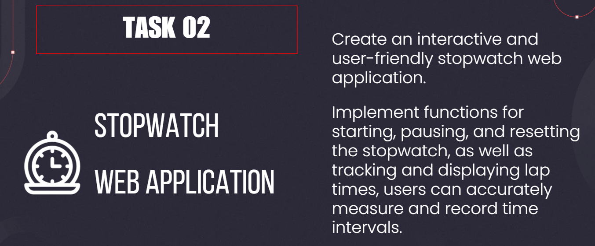

# ⚡ PixSnap

A slick, feature-rich photo gallery progressive web app with a sidebar layout, slideshow player, drag-and-drop upload, favorites collection, fullscreen viewer, and dark/light theme toggle — all in pure HTML, CSS & JavaScript.



---

## ✨ Features

### 🖼️ Gallery View
- Responsive **Grid & List** layout toggle
- **Sort** photos by Default, A→Z, Z→A, or Liked First
- Live **search** bar in the top navigation
- Like / unlike photos with a 💜 button
- Open any photo in a **full-screen lightbox** with next/prev navigation

### ▶️ Slideshow View
- Animated automatic slideshow with **Play / Pause** control
- Adjustable **speed slider** (1×–10×)
- **Thumbnail strip** for quick jumping between slides
- **Fullscreen** mode via the browser Fullscreen API

### ⬆️ Upload View
- **Drag & drop** images directly onto the drop zone
- Or use **Browse Files** to pick from your device
- Instant preview grid of all uploaded images
- Uploaded images appear in the Gallery and Slideshow

### 💜 Favorites View
- Dedicated page showing only **liked photos**
- Empty-state message when no photos are liked yet

### 🎨 Theme Toggle
- One-click **dark ↔ light mode** switch in the sidebar footer

---

## 🛠️ Tech Stack

| Technology | Purpose |
|---|---|
| HTML5 | Page structure & multi-view layout |
| CSS3 | Glassmorphism, sidebar, animations |
| Vanilla JavaScript (ES6+) | All app logic — views, slideshow, upload, favorites |
| Google Fonts (Syne + Inter) | Premium typography |

> Zero dependencies. No build step. Open `index.html` and go.

---

## 🚀 Getting Started

```bash
# 1. Clone or download the project
git clone <your-repo-url>

# 2. Open in your browser — no server required
start index.html      # Windows
open index.html       # macOS
```

---

## 📁 Project Structure

```
PixSnap/
├── index.html      ← Full app layout (sidebar + 4 views + lightbox)
├── style.css       ← Sidebar, grid, slideshow, lightbox & theme styles
├── app.js          ← All app logic (gallery, slideshow, upload, favorites)
└── image.png       ← Preview / placeholder image
```

---

## 🎮 How to Use

| Action | How |
|---|---|
| Switch views | Click icons in the left sidebar |
| Search photos | Type in the top search bar |
| Like a photo | Click 💜 on the photo card or inside the lightbox |
| Start slideshow | Go to Slideshow view → click ⏵ Play |
| Change speed | Drag the speed slider in Slideshow view |
| Upload photos | Go to Upload view → drag & drop or Browse Files |
| See favorites | Go to Favorites view |
| Toggle theme | Click the moon/sun icon at the bottom of the sidebar |
| Mobile menu | Tap the ☰ hamburger icon to open the sidebar |

---

## 🌐 Live Demo

> 🔗 **[Add your deployment link here]**

---

## 📄 License

This project is open source and available under the [MIT License](https://opensource.org/licenses/MIT).

---

<p align="center">Made with ⚡ · PixSnap © 2026</p>
